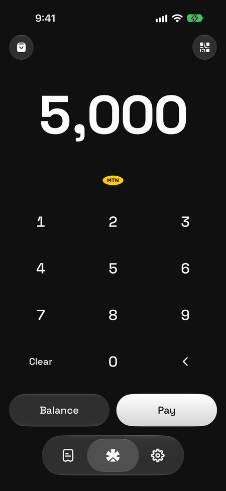
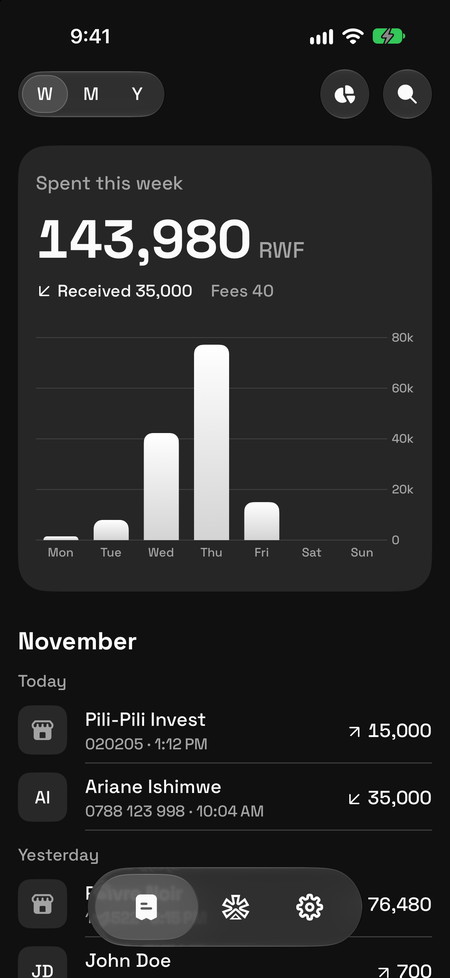
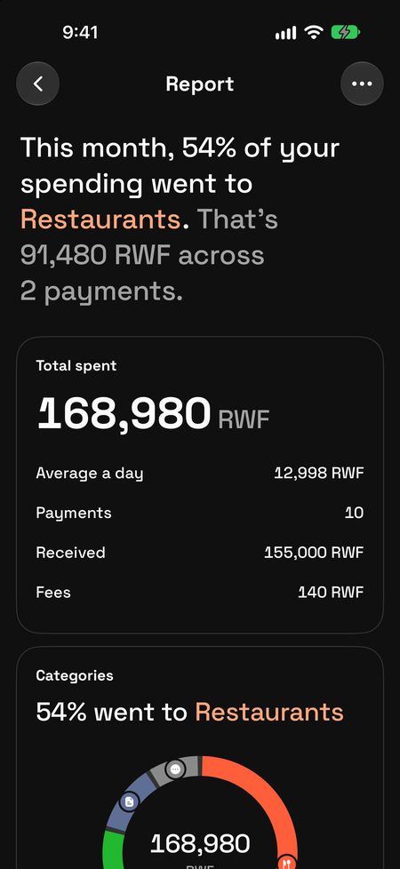
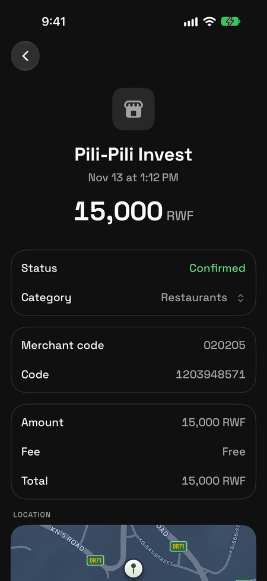
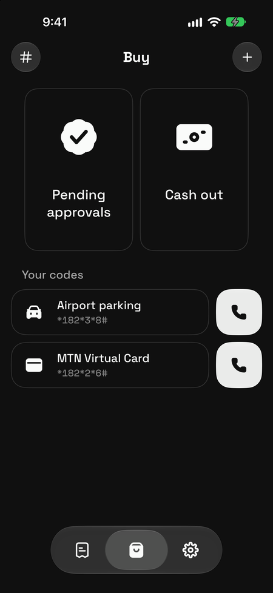
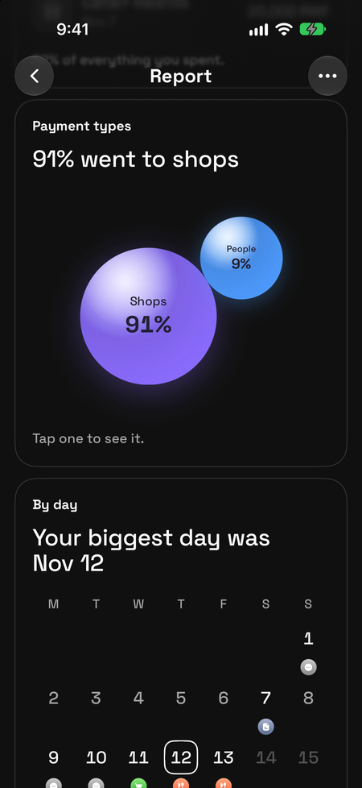

<p align="center">
  <picture>
    <source media="(prefers-color-scheme: dark)" srcset="docs/images/icon-light.png" />
    
  </picture>
</p>

<h1 align="center">StarHash</h1>

<p align="center">
  <b>MTN MoMo and Airtel Money in Rwanda, without the USSD menus</b>
</p>
<p align="center">
  Type an amount, pick who gets it, and StarHash dials the code. Every payment then lands in one place.
</p>

<div align="center">

  
  
  

</div>

<br>

## &nbsp; The Problem
Paying with mobile money in Rwanda still means menus built for a feature phone.

<table width="100%">
  <tr>
    <td width="33%" valign="top" align="center">
      <h3 align="center">USSD menus</h3>
      <p align="center">Every payment is <code>*182#</code>, a number for each menu, the amount and the recipient typed by hand.</p>
    </td>
    <td width="33%" valign="top" align="center">
      <h3 align="center">History in SMS</h3>
      <p align="center">What you paid lives in a thread of carrier messages, with no search and no names.</p>
    </td>
    <td width="33%" valign="top" align="center">
      <h3 align="center">No overview</h3>
      <p align="center">Nothing tells you what a month cost, or where the money went.</p>
    </td>
  </tr>
</table>

<br>

## &nbsp; The Solution
StarHash builds the USSD code for you and keeps the record the carrier never gave you. It never sees your PIN and never moves money itself.

1. **Pay:** type an amount, pick a contact, a recent recipient or a merchant code, or scan a QR code.
2. **Approve:** the iPhone's call prompt shows the whole code; your wallet asks for your PIN as always.
3. **Confirm:** a Shortcuts automation hands the wallet's SMS to StarHash, which marks the payment confirmed with its fee, reference and balance.
4. **Report:** a week, month or year at a glance: the total and how it compares, top categories and payments, a ring of categories, payment types, key days and a saving to try. Export it as a PDF.

The codes and fees are in [Codes and fees](docs/codes-and-fees.md), the automation in [Auto-verify](docs/auto-verify.md), and how the code fits together in [ARCHITECTURE.md](ARCHITECTURE.md).

<br>

## &nbsp; Privacy

| **What** | **Where it goes** |
| :-- | :-- |
| **Payments** | One file on the iPhone, in your own backups. Never sent anywhere. |
| **Your PIN** | Never seen. Your wallet asks for it. |
| **Contacts** | Read on the phone only, to name recipients. |
| **Location** | Only with Nearby on, only while you pay, never for contacts. |
| **Your QR photo** | Sent to StarHash's small server (`server/`) only when you share your code. |
| **Usage** | An anonymous daily count of installs. No analytics, no third-party packages. |

More in [Privacy](docs/privacy.md).

<br>

## &nbsp; Visuals

| Pay | Transactions | Report |
| :---: | :---: | :---: |
| <picture><source media="(prefers-color-scheme: dark)" srcset="docs/images/pay-light.png" /></picture> | <picture><source media="(prefers-color-scheme: dark)" srcset="docs/images/activity-light.png" /></picture> | <picture><source media="(prefers-color-scheme: dark)" srcset="docs/images/report-light.png" /></picture> |
| **A payment** | **Buy** | **Payment types** |
| <picture><source media="(prefers-color-scheme: dark)" srcset="docs/images/transaction-light.png" /></picture> | <picture><source media="(prefers-color-scheme: dark)" srcset="docs/images/buy-light.png" /></picture> | <picture><source media="(prefers-color-scheme: dark)" srcset="docs/images/report-types-light.png" /></picture> |

<br>

## &nbsp; Tech Stack

| **Part** | **Technology** |
| :-- | :-- |
| **App** | Swift 6 and SwiftUI, Liquid Glass on iOS 26 and later, Swift Charts |
| **Core** | `StarHashKit`, a Foundation-only Swift package with Swift Testing tests |
| **Shortcuts and widgets** | App Intents, WidgetKit, a Control Center control |
| **Server** | A Cloudflare Worker with D1 (`server/`) |
| **Languages** | English, French and Kinyarwanda |

<br>

## &nbsp; Getting Started
StarHash is not on the App Store yet, so build it from source. You need a Mac with Xcode 27 and [XcodeGen](https://github.com/yonaskolb/XcodeGen), an iPhone on iOS 18 or later with an MTN or Airtel Rwanda SIM, and an Apple ID to sign with (a free team works).

```bash
git clone https://github.com/devbyshima/starhash.git
cd starhash
brew install xcodegen
xcodegen generate
open StarHash.xcodeproj
```

Set your own `DEVELOPMENT_TEAM` and bundle id in `project.yml`, then run the **StarHash** scheme on your iPhone. The simulator cannot dial; run it with `-inMemory -skipOnboarding` to look around with sample data. Scripts, tests and debug arguments are in [Development](docs/development.md).

<br>

## &nbsp; Roadmap
- [x] **Pay** by contact, recent, merchant code or QR code, on MTN MoMo or Airtel Money
- [x] **Auto-verify** payments from the wallet's SMS
- [x] **Report** with categories, payment types, key metrics and PDF export
- [x] **Widgets**, Shortcuts and Siri, Face ID lock, export and import
- [ ] **App Store** release
- [ ] **Airtel Money** codes and messages checked on a real SIM
- [ ] **Widgets** that read your own codes (needs a paid developer team)

<br>

## &nbsp; Acknowledgements
- [Space Grotesk](https://github.com/floriankarsten/space-grotesk) by Florian Karsten, under the SIL Open Font License 1.1
- [Keyline Icons](https://github.com/keyline-icons/keyline-icons), under the MIT License
- [DiceBear](https://www.dicebear.com)'s Shadows silhouettes, under CC0 1.0

The MTN and Airtel logos are trademarks of MTN Group and Airtel Africa, shown only to tell the two wallets apart; StarHash is not affiliated with either.

StarHash is source-available under the [PolyForm Noncommercial License 1.0.0](LICENSE): use, study and change it for anything non-commercial. The StarHash name and icon are not covered; a modified version needs its own. Versions published before this licence remain under GPL-3.0.

<br>

<div align="center">

[](https://github.com/devbyshima)
[](https://ko-fi.com/devbyshima)

</div>

<p align="center">
  <sub>Made by Shima</sub>
</p>
